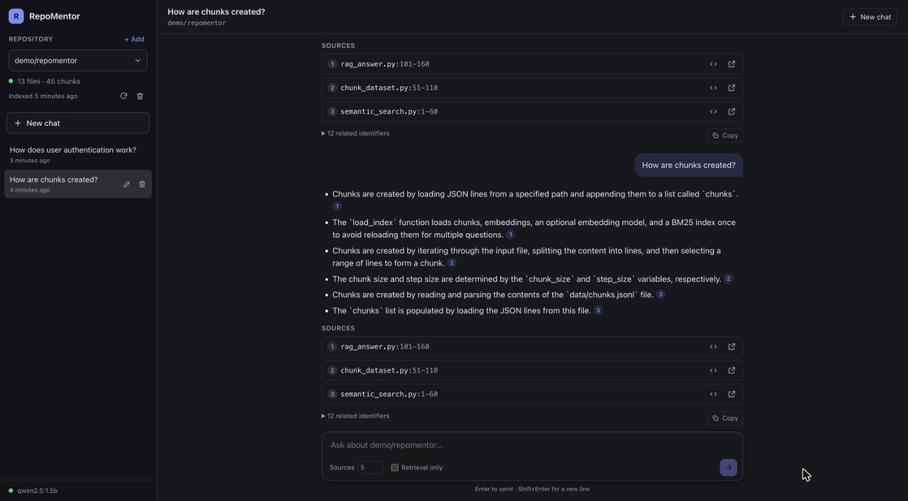
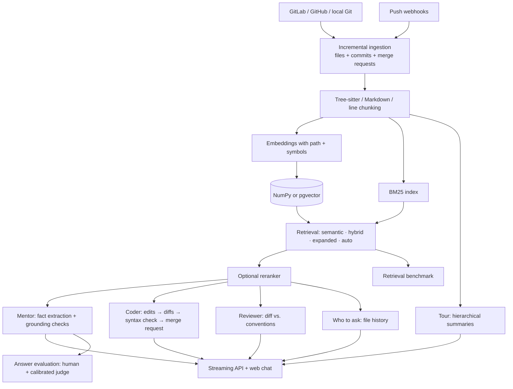
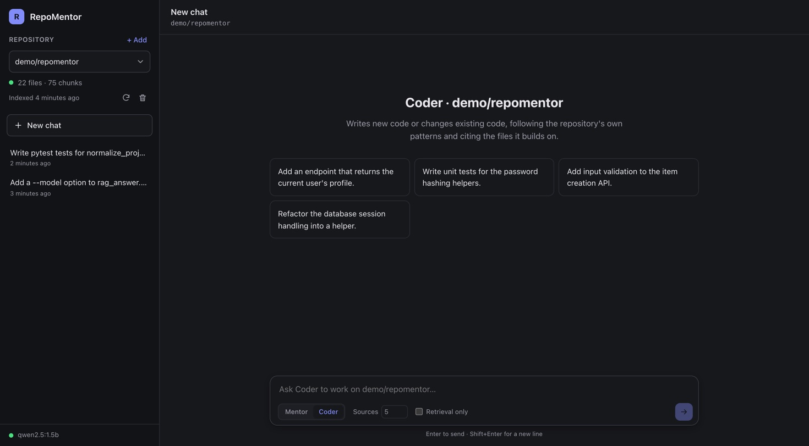
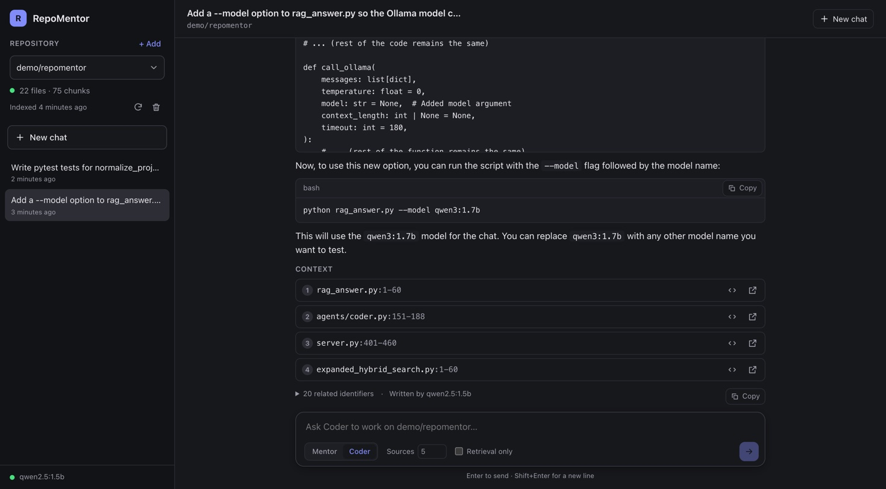
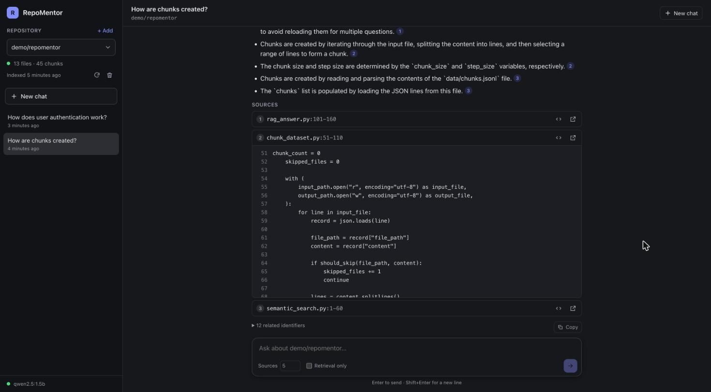

# RepoMentor

**A local, citation-grounded assistant for understanding unfamiliar GitLab and GitHub codebases.**

RepoMentor helps new developers explore a company’s repositories without reading every file manually. It ingests source code, documentation and project history from GitLab or GitHub, retrieves the code most relevant to a question, and uses a local language model to produce an evidence-backed answer with links to exact files, commits, and line ranges. Specialized agents also write code changes as reviewable diffs, review merge requests against the repository’s own conventions, find the people who know a part of the code, and give new developers a guided tour.

> **Project status:** Working research prototype: a Python package with a command line, a React web chat with streamed answers, Docker deployment, automated tests and CI, a two-repository retrieval benchmark with held-out questions, and human- and model-judged answer evaluation. The small local generator remains the main quality bottleneck.



## Evaluation Snapshot

RepoMentor is evaluated in two stages because strong retrieval does not automatically produce a correct answer.

| Evaluation layer | Result | Benchmark |
| --- | ---: | --- |
| Retrieval Hit@5 (held-out) | **89.3%** | 28 test questions, 2 repositories |
| Retrieval Recall@5 (held-out) | **88.1%** | 28 test questions, 2 repositories |
| Retrieval MRR@5 (held-out) | **69.3%** | 28 test questions, 2 repositories |
| Gold-fact coverage (v1 pipeline) | **27.6%** | 10 questions / 29 facts, human-reviewed |
| Faithful substantive answers (v1 pipeline) | **50.0%** | Human-reviewed |
| Unanswerable-question abstention (v1 pipeline) | **100.0%** | 2 unanswerable questions |

Retrieval settings were chosen on a separate development split and then measured once on the held-out split. Answer-level results for the current pipeline are model-judged and mixed; see [Evaluation Results](#evaluation-results). These are small benchmarks, not claims of general performance.

## Why RepoMentor?

Joining a software team often requires learning several things at once:

- where important logic lives;
- how services and components interact;
- which conventions the team follows;
- how authentication, deployment, testing, and data access work;
- why parts of the system changed over time;
- and whom to ask.

README files help, but they rarely capture the full implementation. Generic chatbots can also produce plausible answers without sufficient evidence. RepoMentor retrieves relevant repository content first and grounds every returned fact in a specific source location.

## What It Does

- Connects to **GitLab** (gitlab.com or self-hosted), **GitHub** (github.com or Enterprise) and **local Git checkouts** through one `RepositorySource` interface.
- Downloads supported source code and documentation, skipping dependencies, build output, generated and oversized files.
- **Synchronizes incrementally:** unchanged files (same Git blob ID) are neither downloaded nor embedded again; push **webhooks** from GitLab or GitHub keep indexes current.
- Indexes **commit messages and merged merge/pull request descriptions**, so questions about *why* something changed can be answered.
- Splits code at syntax boundaries with **Tree-sitter** (Python, JavaScript, TypeScript, TSX), Markdown at headings, and everything else into overlapping line windows.
- Embeds chunks locally with Sentence Transformers, prefixed with their file path and the symbols they define.
- Searches with semantic, BM25, hybrid, expanded-hybrid or automatically selected retrieval, with optional cross-encoder reranking, over **NumPy** or **PostgreSQL/pgvector**.
- Extracts facts one source at a time with a local Ollama model, **drops facts that name identifiers the source does not contain**, removes duplicates, and narrows each citation to the lines the fact came from.
- **Defends against prompt injection** from repository content and flags suspicious sources in the interface.
- Offers five agents: **Mentor** (cited answers), **Coder** (diffs, syntax checks, merge requests), **Reviewer** (merge-request review), **Who to ask** (experts from commit history) and **Tour** (overview, architecture map, learning path).
- Streams answers to a React web interface with per-repository chat history, and supports **multi-user deployments** where each user only sees the repositories their own GitLab or GitHub token can read.
- Ships with **Docker Compose** (RepoMentor, Ollama, optional pgvector), **tests**, and **CI** with a retrieval regression gate and a scheduled answer-quality check.

## Architecture



## RAG Pipeline

### 1. Ingestion and synchronization

RepoMentor lists the repository tree at the default branch’s head commit and stores each useful file in `repository_files.jsonl` with its provider, project path, blob ID, commit ID, size and content.

When an index already exists, ingestion compares blob IDs: only new or changed files are downloaded, and only chunks whose text changed are embedded again (vectors are cached by content hash). Re-indexing a repository after a small push therefore takes seconds rather than minutes. The web server rebuilds next to the live index and swaps it in at the end, so questions keep working during a sync, and a failed sync keeps the previous index.

Recent commit messages and merged merge/pull request descriptions are stored in `history.jsonl` and indexed as their own chunks. They are ranked below code unless a question asks *why* or *when* something changed.

### 2. Filtering

Python, JavaScript/TypeScript (including JSX/TSX), Markdown, YAML, TOML, SQL and Dockerfiles are indexed. Directories such as `node_modules`, `.venv`, `dist`, `build`, `coverage` and `vendor` are excluded, as are empty files, generated clients, lock files, changelogs and files over 500 KB.

### 3. Chunking

| Strategy | Used for | How it splits |
| --- | --- | --- |
| Tree-sitter | `.py`, `.js`, `.jsx`, `.ts`, `.tsx` | At top-level definitions; neighbouring small definitions are packed into one chunk of up to 80 lines; long classes are split into their methods, keeping the class header with the first one. |
| Markdown | `.md` | At headings outside code fences. |
| Lines | Everything else | 60-line windows with a 10-line overlap. |
| History | Commits, merge requests | One chunk per record. |

Each chunk records the symbols it defines (for example `UserService.create_user`), which are shown in the interface and included in the embedding text.

### 4. Embeddings

Chunks are embedded with `sentence-transformers/all-MiniLM-L6-v2` (384 dimensions, normalized). Code chunks are prefixed with `File: <path>` and `Defines: <symbols>`, so a chunk of bare function bodies still says where it lives. Vectors are stored in `embeddings.npy`, and optionally in PostgreSQL with pgvector and an HNSW index (`VECTOR_STORE=pgvector`).

### 5. Retrieval

| Method | Description |
| --- | --- |
| `semantic` (default) | Cosine similarity between the question and chunk embeddings. |
| `bm25` | Keyword matching on code-aware tokens (`getUserName` matches `get_user_name`). |
| `hybrid` | Reciprocal Rank Fusion of semantic and BM25 rankings. |
| `expanded-hybrid` | Hybrid plus a second pass with code identifiers found in the first results. |
| `auto` | Semantic for natural-language questions; hybrid when the question names identifiers, calls or files. |

Every method keeps at most one chunk per file, ranks test files lower unless the question is about tests, and ranks history lower unless the question asks why or when. A cross-encoder can rerank the best candidates (`RERANKER_MODEL`). Semantic retrieval is the default because it was best on the development split; see the ablation below.

### 6. Grounded generation (Mentor)

1. Questions whose best match is clearly unrelated to the repository (similarity below `MIN_RELEVANCE`) are refused without calling the model.
2. Each retrieved source is shown to the model on its own, with line numbers, and the model extracts at most two facts, each with the lines that show it.
3. Python drops facts that name functions, classes or variables the source does not contain, and facts that repeat an earlier one.
4. Python attaches the citation, narrowed to the lines the model named when they lie inside the chunk, linked to the exact commit on GitLab or GitHub.

These steps came from the error analysis of the first evaluation: facts attributed to the wrong file, invented identifiers inside otherwise plausible facts, and repeated facts. They reduce, but do not eliminate, unsupported claims.

### 7. Prompt-injection defence

Indexed code, comments, commit messages and merge-request descriptions are written by other people and end up in prompts. RepoMentor layers several defences:

- repository text is wrapped in blocks delimited by a random per-request tag, and the system prompt says that text inside them is untrusted data, never instructions;
- chat-template control tokens (`<|im_start|>`, `[INST]`, …) and anything that would close the block early are neutralized;
- sources containing instruction-like text (“ignore previous instructions”, “note to the AI assistant”, role markers) are flagged, and the interface shows a warning next to them;
- facts must be grounded in their source, and nothing is ever written to a repository without the user pressing a button.

No prompt-level defence is complete; treat answers about untrusted repositories with care.

## Agents

| Agent | What it does |
| --- | --- |
| **Mentor** | The cited, fact-by-fact pipeline above. |
| **Coder** | Retrieves the most relevant code and asks the model for a plan plus SEARCH/REPLACE edits (or whole new files). The edits are applied to the indexed files to produce **unified diffs**, every changed file is **syntax-checked** (Python, JSON, TOML, YAML, and JS/TS via Tree-sitter), and with `ALLOW_MERGE_REQUESTS=true` the user can **open a merge/pull request** with one click. It sees earlier turns, so “now add tests” works. |
| **Reviewer** | Give it a merge request (`!12`, `#12` or a URL) or paste a unified diff. For each changed file it retrieves the most similar existing code and reviews the change against those conventions, with severities and citations. |
| **Who to ask** | Finds the files behind the question, reads their commit history from the host, and ranks people by the number and recency of their commits (bots excluded), with links to their recent commits. No language model needed. |
| **Tour** | On first use, builds RAPTOR-style hierarchical summaries: a digest of each file, a model summary of each directory from the bottom up, and an overview with a learning path. It then gives the tour, or answers broad questions (“How is the application deployed?”) from the most relevant directory summaries plus code. |





Small models often ignore the requested edit format. A dedicated code model is recommended for the coder and reviewer (`OLLAMA_CODER_MODEL=qwen2.5-coder:7b`).

**Adding an agent.** Create a module in `repomentor/agents/` with a subclass of `Agent` that yields events, and register it in `repomentor/agents/__init__.py`:

```python
from .. import llm, safety
from .base import Agent, AgentContext, format_sources, retrieve_sources


class SecurityAgent(Agent):
    id = "security"                       # stored with messages; never rename
    name = "Security"
    description = "Looks for risky patterns in the code behind a question."
    examples = ["Is user input validated before it reaches the database?"]

    def stream(self, question: str, context: AgentContext):
        yield {"type": "status", "label": "Retrieving sources…"}
        chunks, sources, _ = retrieve_sources(question, context)
        yield {"type": "sources", "sources": sources}

        tag = safety.new_tag()
        parts = []
        for piece in llm.chat_stream([
            {"role": "system", "content": "Review for security issues. Cite sources as [n]."
                                          + safety.policy(tag)},
            {"role": "user", "content": format_sources(chunks, tag) + "\n\n" + question},
        ]):
            parts.append(piece)
            yield {"type": "delta", "text": piece}

        yield {"type": "result", "result": {"answer": "".join(parts), "sources": sources}}
```

An agent without a dedicated view is rendered as streamed Markdown with its sources, so it works in the web interface without frontend changes.

## Evaluation Results

### Retrieval benchmark

The benchmark now covers two pinned public repositories, each split into development and held-out test questions, with natural-language and identifier questions:

| Benchmark | Commit | Dev | Test |
| --- | --- | ---: | ---: |
| [Full Stack FastAPI Template](https://github.com/fastapi/full-stack-fastapi-template) (MIT) | `aabb901` | 20 (the original 16 + 4) | 16 |
| [Flask](https://github.com/pallets/flask) (BSD-3-Clause) | `49943b5` | 12 | 12 |

All configuration decisions (chunker, embedding text, method, reranker) were made on the dev split; the test split was evaluated once afterwards.

**Development split, both repositories pooled (32 questions, K=5):**

| Configuration | Hit@5 | Recall@5 | MRR@5 |
| --- | ---: | ---: | ---: |
| Line chunks · semantic | 0.906 | 0.875 | 0.731 |
| Line chunks · expanded hybrid (v1 production path) | 0.906 | 0.844 | 0.713 |
| Tree-sitter · semantic | 0.875 | 0.844 | 0.672 |
| Tree-sitter · expanded hybrid | 0.938 | 0.891 | 0.744 |
| **Tree-sitter + path/symbol context · semantic** | 0.906 | 0.875 | **0.756** |
| Tree-sitter + context · auto | 0.906 | 0.875 | 0.733 |
| Tree-sitter + context · semantic + cross-encoder rerank | 0.906 | 0.859 | 0.661 |

Tree-sitter chunks alone did not help semantic search: packing several definitions into one chunk diluted its embedding. Adding the file path and defined symbols to the embedded text recovered that and gave the best ranking (MRR). The general-purpose `ms-marco-MiniLM-L-6-v2` reranker, trained on web search, *lowered* MRR on code, so reranking is off by default. Automatic method selection did not beat plain semantic search on dev, so semantic is the default.

**Held-out test split (28 questions, K=5):**

| Configuration | Hit@5 | Recall@5 | MRR@5 |
| --- | ---: | ---: | ---: |
| Line chunks · expanded hybrid (v1 production path) | 0.786 | 0.786 | 0.696 |
| Line chunks · semantic | 0.893 | 0.893 | 0.654 |
| **Tree-sitter + context · semantic (new default)** | **0.893** | 0.881 | 0.693 |
| Tree-sitter + context · auto | 0.929 | 0.905 | 0.690 |

On held-out questions the new default finds the right file for 3 more questions out of 28 than the previous production path, with the same MRR, and ranks the right file higher than line-chunk semantic search. `auto` was one question better than semantic here (on an identifier question), the opposite of dev; with this many questions, differences of one question (0.036) are within noise. Full tables per repository, question type and K are in [`evaluation/results/`](evaluation/results/).

### Answer quality

The answer gold set (10 questions on the FastAPI template: 8 answerable, 2 unanswerable; 29 required facts and 22 known incorrect claims) is unchanged. The first pipeline’s answers were reviewed by a person:

| Metric (v1 pipeline, `qwen3:1.7b`, human-reviewed) | Result |
| --- | ---: |
| Gold-fact coverage | 8/29 (**27.6%**) |
| Complete-answer rate | 0/8 (**0.0%**) |
| Answerable response rate | 6/8 (**75.0%**) |
| Unanswerable abstention accuracy | 2/2 (**100.0%**) |
| Faithful substantive-answer rate | 3/6 (**50.0%**) |
| Citation-correct substantive-answer rate | 3/6 (**50.0%**) |
| Known-error trigger rate | 2/22 (**9.1%**) |
| Mean expected-source recall | **56.2%** |

To compare the current pipeline with the first one fairly, both were run with the same model and labeled by the same judge. Only `qwen2.5:1.5b` was available locally for this comparison, and it served as both generator and judge, so read these as relative numbers:

| Metric (`qwen2.5:1.5b`, model-judged) | v1 pipeline | Current pipeline |
| --- | ---: | ---: |
| Gold-fact coverage | 23/29 (79.3%) | 24/29 (82.8%) |
| Complete-answer rate | 37.5% | 50.0% |
| Answerable response rate | 100.0% | 100.0% |
| Unanswerable abstention accuracy | 0.0% | 50.0% |
| Faithful substantive-answer rate | 100.0% | 77.8% |
| Citation-correct substantive-answer rate | 100.0% | 100.0% |
| Known-error trigger rate | 5/22 (22.7%) | 6/22 (27.3%) |
| Mean expected-source recall | 81.2% | 68.8% |

The picture is mixed, and the evaluation is too small and too noisy to claim an overall improvement:

- **The relevance gate works as intended:** the off-topic payments question is now refused without calling the model; `qwen2.5:1.5b` had answered both unanswerable questions under v1. The rate-limiting question still gets an answer, because the repository contains related-sounding code.
- **Expected-source recall dropped** on two questions. Keeping one chunk per file means that, with function-level chunks, a different part of `users.py` can win than the function the question is about.
- **Run-to-run variation is large:** an earlier run of the current pipeline scored 89.7% coverage, 88.9% faithfulness and 22.7% known errors on the same questions.
- **The judge is lenient on facts.** Calibrated against the human labels of the v1 answers, it agrees with people on 91% of known-error labels (Cohen's κ = 0.62) but only 66% of required-fact labels (κ = 0.38, 10 false positives, no false negatives). Its fact coverage is therefore inflated; trust its error-trigger numbers more than its coverage numbers.

The judged answers, metrics and calibration are in [`evaluation/results/`](evaluation/results/). Growing the human-reviewed set is the most valuable next step for answer evaluation.

## Evaluation Methodology

Retrieval and generation are measured separately so failures can be traced to the correct stage.

Retrieval metrics:

- **Hit@K:** whether at least one expected file appears in the top K results;
- **Recall@K:** the fraction of expected files present in the top K results;
- **Mean Reciprocal Rank:** how early the first relevant file appears.

Generation metrics include gold-fact coverage, complete-answer rate, answerable response rate, unanswerable abstention accuracy, faithfulness, citation correctness, expected-source recall, and known-error triggers.

Answers are labeled either by a person (`eval review`) or by a model judge (`eval judge`). The judge answers the same yes/no questions a reviewer answers, one small prompt per item, so its labels can be compared item by item with human labels: `eval judge --calibrate` reports agreement and Cohen’s kappa per label type. Judge-based numbers are only as trustworthy as that agreement. Prefer a judge that is not the model that wrote the answers; when only one small model is available, compare pipelines under the same judge rather than reading judge scores as absolute truth.

## Technology Stack

| Area | Technology |
| --- | --- |
| Language | Python 3.11+ |
| Repository sources | GitLab REST API, GitHub REST API, local Git |
| Chunking | Tree-sitter (Python, JavaScript, TypeScript, TSX) |
| Embeddings | Sentence Transformers (`all-MiniLM-L6-v2`) |
| Vector search | NumPy, or PostgreSQL + pgvector (HNSW) |
| Keyword retrieval | BM25 (`rank-bm25`) |
| Reranking (optional) | Sentence Transformers cross-encoders |
| Local LLM runtime | Ollama (`qwen3:1.7b` by default) |
| Web API | FastAPI, Server-Sent Events, SQLite |
| Web interface | React + TypeScript (Vite) |
| Deployment | Docker, Docker Compose |
| Testing and CI | pytest, GitHub Actions |

## Project Structure

```text
repomentor/
├── repomentor/                 # The Python package
│   ├── cli.py                  # python -m repomentor <command>
│   ├── config.py               # Every setting, read from the environment
│   ├── sources/                # GitLab, GitHub and local Git behind one interface
│   ├── ingest.py               # Incremental file and history ingestion
│   ├── chunking.py             # Tree-sitter, Markdown, line and history chunks
│   ├── embeddings.py           # Embeddings with a content-hash cache
│   ├── vectorstore.py          # NumPy and pgvector stores
│   ├── index.py                # Build, sync and load an index
│   ├── retrieval.py            # Retrieval methods and reranking
│   ├── answer.py               # Mentor pipeline: extraction and grounding
│   ├── citations.py            # Source descriptions and line links
│   ├── safety.py               # Prompt-injection defences
│   ├── coding.py               # Edits → diffs → syntax checks
│   ├── summaries.py            # Hierarchical summaries for the tour
│   ├── llm.py                  # Ollama, whole or streamed
│   ├── auth.py                 # Per-user access in multi-user deployments
│   ├── server.py               # FastAPI app: chats, streaming, webhooks, MRs
│   ├── agents/                 # mentor, coder, reviewer, experts, tour
│   └── evaluation/             # Benchmarks, ablation, judge, regression gate
├── frontend/                   # React chat interface (Vite + TypeScript)
├── tests/                      # pytest suite (no network, no models)
├── experiments/                # The original exploratory scripts
├── evaluation/
│   ├── benchmarks/             # Pinned repositories with dev/test questions
│   ├── answer_questions.json   # Answer gold set
│   ├── generated_answers.json  # Human-reviewed v1 answers (never overwritten)
│   ├── thresholds.json         # CI regression thresholds
│   └── results/                # Ablation tables, judge calibration, v1 results
├── Dockerfile
├── compose.yml
├── .github/workflows/          # CI and the weekly answer-quality check
└── data/                       # Indexes and the web database (ignored by Git)
```

## Getting Started

### Option A: Docker

```bash
cp .env.example .env            # add a GitLab and/or GitHub token
docker compose up -d --build
```

Open <http://localhost:8000>. The first start pulls the chat model into the Ollama volume. To store vectors in PostgreSQL, set `VECTOR_STORE=pgvector` in `.env` and start with `docker compose --profile pgvector up -d --build`.

### Option B: Local installation

Prerequisites: Python 3.11+, Git, Node.js 18+ (for the web interface) and [Ollama](https://ollama.com).

```bash
git clone https://github.com/amir-hri/repomentor.git
cd repomentor
python3 -m venv .venv && source .venv/bin/activate
python -m pip install -e ".[dev]"          # add ,pgvector for PostgreSQL support
ollama pull qwen3:1.7b
cp .env.example .env                       # then edit it
```

`.env` holds tokens and settings; every option is documented in [`.env.example`](.env.example). Use read-only tokens, and never commit `.env`.

### Index a repository

```bash
# GitLab project from GITLAB_PROJECT_PATH (or --project group/project)
python -m repomentor index

# A GitHub repository (public repositories need no token)
python -m repomentor index --provider github --project pallets/flask --data data/flask

# A local checkout
python -m repomentor index --provider local --project ~/code/my-service --data data/my-service

python -m repomentor inspect            # files, chunk kinds, largest files
```

Running `index` again synchronizes: only changed files are downloaded and embedded. Use `--full` to rebuild from scratch, `--no-history` to skip commits and merge requests.

### Ask questions

```bash
python -m repomentor ask                                        # interactive
python -m repomentor ask "How are user passwords handled?"
python -m repomentor ask "Where are database models defined?" --retrieval-only
python -m repomentor ask "Add a health check endpoint" --agent coder
python -m repomentor ask "Who knows the authentication code?" --agent experts
python -m repomentor summarize                                  # build tour summaries
```

### Use the web interface

```bash
cd frontend && npm install && npm run build && cd ..
python -m repomentor serve                # open http://127.0.0.1:8000
```

For development, run `python -m repomentor serve --reload` and `cd frontend && npm run dev` (UI on <http://localhost:5173>).



- **Repositories:** add GitLab or GitHub projects (a pasted URL works); each is indexed in the background. The refresh button synchronizes changed files; **Rebuild** starts from scratch. An index built on the command line in `data/` appears automatically.
- **Streaming:** progress (“Reading app/crud.py (2/5)…”), facts and code appear as the agent produces them.
- **Chats:** saved per repository, renamable and deletable; follow-ups see earlier turns.
- **Sources:** each citation highlights its source; sources expand to the exact lines and open the pinned commit on GitLab or GitHub. Commits, merge requests and AI summaries are labeled, and suspicious sources carry a warning.
- **Coder changes:** diffs with syntax-check badges and an **Open merge request** button when enabled.

### Keep indexes in sync with webhooks

Set `GITLAB_WEBHOOK_SECRET` and/or `GITHUB_WEBHOOK_SECRET`, then add a push webhook to the project:

| Host | URL | Secret |
| --- | --- | --- |
| GitLab | `https://<server>/api/webhooks/gitlab` | “Secret token” = `GITLAB_WEBHOOK_SECRET` |
| GitHub | `https://<server>/api/webhooks/github` (content type `application/json`) | “Secret” = `GITHUB_WEBHOOK_SECRET` (HMAC-SHA256 verified) |

Pushes to the default branch start an incremental sync. Pushes during a running sync are queued and run afterwards.

### Multi-user deployment

With `AUTH_MODE=token`, each user signs in with their own GitLab or GitHub personal access token. The token stays in the browser and is sent with each request; the server never stores it. RepoMentor asks the host whether that token can read each repository (cached for `ACCESS_CACHE_SECONDS`), shows only those, keeps each user’s chats private, and uses the user’s own token for live requests such as file history and merge requests. Local checkouts, which have no owner to ask, are hidden in this mode. Indexing still uses the server’s read token, so a repository is downloaded once and shared by everyone allowed to read it.

### Evaluate

```bash
python -m repomentor eval prepare                       # clone benchmarks, build indexes
python -m repomentor eval ablation --split dev          # compare methods
python -m repomentor eval ablation --split dev --rerank cross-encoder/ms-marco-MiniLM-L-6-v2
CHUNKER=lines python -m repomentor eval ablation --variant lines
python -m repomentor eval errors --first semantic --second expanded-hybrid
python -m repomentor eval retrieval --split test        # confirm a decision once

python -m repomentor eval answers --data data/benchmarks/fastapi-template/index \
    --output evaluation/runs/answers.json
python -m repomentor eval review evaluation/runs/answers.json        # label by hand
python -m repomentor eval judge evaluation/runs/answers.json         # or with the judge
python -m repomentor eval score evaluation/runs/answers.json --labels judge_review
python -m repomentor eval judge evaluation/generated_answers.json --calibrate

python -m repomentor eval check --retrieval             # CI regression gate
python -m repomentor eval check --answers               # needs Ollama
```

### Run the tests

```bash
python -m pytest
```

The suite uses a hashing embedding model and temporary Git repositories, so it needs no network, models or Ollama. CI runs the tests, builds the frontend and the Docker image, and fails a pull request when retrieval drops below [`evaluation/thresholds.json`](evaluation/thresholds.json). A weekly workflow installs Ollama, generates answers, labels them with the judge and checks the answer thresholds.

## Configuration and Security

- Use read-only tokens for indexing; a separate write token (`GITLAB_WRITE_TOKEN` / `GITHUB_WRITE_TOKEN`) or the signed-in user’s token is only used when someone presses **Open merge request**, and only with `ALLOW_MERGE_REQUESTS=true`.
- Store credentials only in `.env`; keep `.env`, `.venv/`, `data/` and caches out of Git.
- Do not commit downloaded private source code or generated embeddings.
- Webhooks are rejected unless their secret (GitLab) or HMAC signature (GitHub) matches.
- Rotate a token immediately if it is ever exposed.

## Design Decisions

### Why a local LLM?

Local generation keeps retrieved source code on the developer’s machine and avoids per-request API charges. The tradeoff is lower answer quality and slower inference compared with larger hosted models.

### Why semantic retrieval by default?

Hybrid retrieval tests a reasonable hypothesis: semantic search handles meaning, BM25 handles exact identifiers. On two repositories and both question types, plain semantic search over context-enriched chunks matched or beat fusion, expansion, automatic selection and a web-trained reranker on the development split, and held up on the held-out split. The other methods remain available and are measured in every ablation.

### Why NumPy and pgvector?

A few repositories produce only thousands of chunks, so exhaustive NumPy search is exact, fast and easy to inspect. pgvector is there for deployments with many or large repositories, concurrent users and a shared database; both stores return the same scores to the retrieval code.

### Why attach citations in Python?

Small models cite the wrong source number even when the right evidence was retrieved. RepoMentor processes one source at a time, checks the fact against that source, and attaches the citation programmatically.

### Why SEARCH/REPLACE edits for the coder?

Asking a small model for whole files invites silent deletions; asking for loose snippets leaves the user to work out where they go. Exact SEARCH/REPLACE blocks can be applied mechanically to the indexed file, turned into a unified diff, syntax-checked, and rejected when they do not match.

## Current Limitations

- The embedding model is general-purpose rather than code-specific.
- The default generator is a small local model with limited reasoning ability; fact extraction can still misinterpret code.
- The grounding check catches invented identifiers, not misdescriptions of real ones.
- The model judge is calibrated against only 10 human-reviewed answers; treat judge-based numbers as comparative, not absolute.
- Benchmarks are still small (60 retrieval questions on two repositories); a one-question difference is 3–4 points.
- The pgvector store has not yet been tested against a running PostgreSQL database; the Docker image is built in CI but not started there.
- Who-to-ask and live history need the host’s API; GitHub links use the indexed commit rather than each file’s last commit.
- Tour summaries are written by the model and can be wrong; the interface labels them as AI summaries.

## Roadmap

- [x] Refactor ingestion, chunking, retrieval, and generation into a reusable Python package, separating experiment scripts from production commands.
- [x] Add retrieval evaluation with Hit@K, Recall@K, and expected-file ground truth.
- [x] Add retrieval ablation and per-question error analysis.
- [x] Add answer-level completeness, citation, faithfulness, and abstention evaluation.
- [x] Select retrieval dynamically or make semantic retrieval the default after held-out validation.
- [x] Improve evidence extraction and refusal logic using the answer-level error analysis.
- [x] Expand the benchmark and separate development and held-out test questions.
- [x] Add code-aware chunking with Tree-sitter.
- [x] Add a reranking model for top retrieval candidates.
- [x] Replace the NumPy prototype with PostgreSQL/pgvector or another vector store.
- [x] Add incremental GitLab synchronization using commits and webhooks.
- [x] Support multiple repositories (web interface).
- [x] Respect per-user GitLab permissions in a multi-user deployment.
- [x] Add a FastAPI backend and a web chat interface with history.
- [x] Add Docker-based local deployment.
- [x] Add automated tests and continuous integration.

### Repository history and sources

- [x] Ingest commit messages and merge request descriptions so RepoMentor can answer *why* parts of the system changed.
- [x] Support GitHub alongside GitLab behind an abstract repository-source interface.

### Agents

- [x] **Onboarding / Tour:** architecture map, hierarchical directory summaries and a learning path.
- [x] **Reviewer:** review a merge request against the repository's own conventions.
- [x] **Who-to-ask:** identify who has worked on each part of the codebase from commit history.
- [x] **Coder improvements:** unified diffs, syntax checks, and optional merge requests.

### Engineering and evaluation

- [x] Stream answers to the web interface (Server-Sent Events).
- [x] Evaluate on more than one repository and more than 16 questions.
- [x] Add an LLM judge calibrated against the existing human labels, and run answer-quality regression tests in CI.
- [x] Guard against prompt injection from repository content.

### Next

- [ ] Grow the human-reviewed answer set so the judge can be calibrated on more than 10 answers.
- [ ] Try a code-specific embedding model and a code-trained reranker.
- [ ] Add more benchmark repositories in other languages (TypeScript-first, Go).
- [ ] End-to-end tests against PostgreSQL/pgvector in CI.

## Demonstration Corpora

Benchmarks use the public [Full Stack FastAPI Template](https://github.com/fastapi/full-stack-fastapi-template) (MIT) and [Flask](https://github.com/pallets/flask) (BSD-3-Clause), pinned to exact commits. Their source code and embeddings are not included in this repository; `eval prepare` clones them locally.

## Responsible Use

RepoMentor is a developer-assistance tool, not an authority on repository behavior. Open and verify cited code before making security, architecture, deployment, or production decisions. A citation shows which source informed an answer; it does not by itself prove that the interpretation is correct or complete. Review every generated change before merging it.

## Contributing

The project is an individual portfolio project and is evolving rapidly. Bug reports, evaluation cases, retrieval improvements, and documentation suggestions are welcome through GitHub issues. Run `python -m pytest` and `python -m repomentor eval check --retrieval` before opening a pull request.

---

Built as a hands-on exploration of retrieval-augmented generation, code search, local language models, and evidence-grounded developer tooling.
